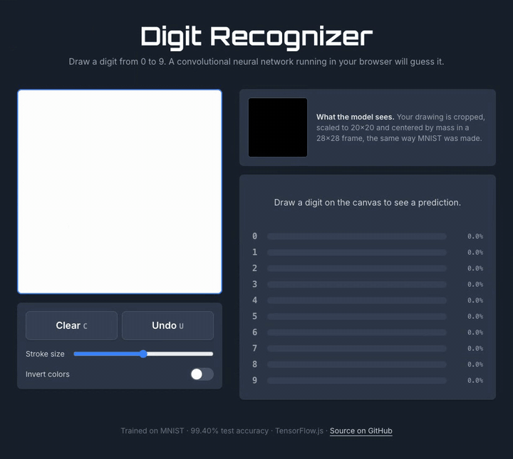

# Digit Recognizer

[](https://github.com/JonathanSContreras/digit-recognizer/actions/workflows/ci.yml)
[](https://hand-rec.vercel.app)
[](LICENSE)

Draw a digit and a convolutional neural network guesses it as you draw. I trained the model myself on MNIST (**99.40% test accuracy**), and it runs entirely in the browser with TensorFlow.js. There's no backend, and each prediction takes a few milliseconds.

**[Try it live →](https://hand-rec.vercel.app)**



## How it works

```
canvas (384×384) ──► preprocess ──► 28×28 tensor ──► CNN (TensorFlow.js) ──► probabilities for 0–9
```

1. **Drawing.** Pointer events cover mouse, touch and pen with one code path. Strokes are kept as point lists so undo is just "drop the last stroke".
2. **Preprocessing** ([`src/lib/preprocess.ts`](src/lib/preprocess.ts)). A model is only as good as how closely its input matches its training data, so the drawing is normalized the same way the MNIST digits were:
   - crop to the bounding box of the ink
   - scale the longest side to 20px, **keeping the aspect ratio** (otherwise a "1" gets stretched into a block) and area-averaging so strokes get MNIST's soft edges
   - paste into a 28×28 frame so the digit's **center of mass** sits in the middle

   The app shows this 28×28 image next to the prediction, so you can see exactly what the model sees. The function is pure (no DOM), so it's unit tested.
3. **Inference** ([`src/lib/inference.ts`](src/lib/inference.ts)). The model loads once from `public/model`, and a warm-up pass keeps the first real prediction from being slow. A request counter discards results from a drawing that has since changed.

## The model

Trained from scratch with [`training/train.js`](training/train.js) on TensorFlow.js for Node.

| Layer | Output |
| --- | --- |
| Conv 3×3, 32 filters + BatchNorm + MaxPool | 13×13×32 |
| Conv 3×3, 64 filters + BatchNorm + MaxPool | 5×5×64 |
| Dropout 0.3 → Dense 128 → Dropout 0.4 | 128 |
| Dense 10, softmax | 10 |

- **225k parameters** (about 900 KB of weights), so the page loads fast.
- **Data augmentation:** each epoch, training digits get a random rotation (±12°), scale (±12%) and shift (±2.5px). MNIST digits are tidy and hand-drawn ones aren't, and augmentation made the model noticeably more forgiving of messy input.
- **Results:** 99.40% accuracy on the 10,000-image MNIST test set after 10 epochs (see [`public/model/metrics.json`](public/model/metrics.json)).

## Tech stack

Next.js 15 (App Router) · React 19 · TypeScript · Tailwind CSS v4 · TensorFlow.js · Vitest · GitHub Actions

## Running locally

Requires Node.js 20+.

```bash
git clone https://github.com/JonathanSContreras/digit-recognizer.git
cd digit-recognizer
npm install
npm run dev        # http://localhost:3000
```

| Command | What it does |
| --- | --- |
| `npm run dev` | Start the dev server |
| `npm test` | Run unit tests (Vitest) |
| `npm run lint` / `npm run typecheck` | ESLint and TypeScript checks |
| `npm run build` | Production build |

### Retraining the model

Training is its own package, so the web app never installs native TensorFlow.

```bash
cd training
npm install
npm run train -- --epochs 10   # writes ../public/model (model.json, weights, metrics.json)
```

Options: `--epochs`, `--batch-size`, `--out`, `--no-augment`. On an M-series MacBook, a 10-epoch run takes about 6 minutes on CPU.

## Project structure

```
src/
  app/page.tsx              page: wires canvas → preprocessing → model → results
  components/               DrawingCanvas, Controls, Results
  lib/preprocess.ts         MNIST-style normalization (+ tests)
  lib/inference.ts          model loading and prediction (+ tests)
training/                   Node training pipeline (data loading, augmentation, model, train loop)
public/model/               trained model served to the browser
```

## What I'd do next

- Collect drawings from the live site (with consent) and fine-tune on them, since real users draw differently from MNIST's writers
- Quantize the weights to shrink the download further
- Recognize multi-digit numbers by segmenting strokes into separate digits

## License

[MIT](LICENSE)
